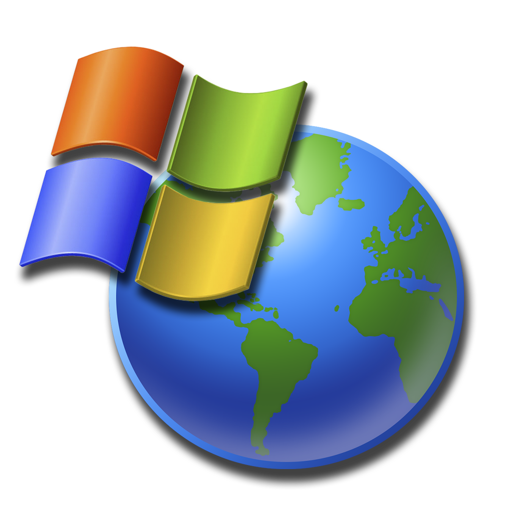
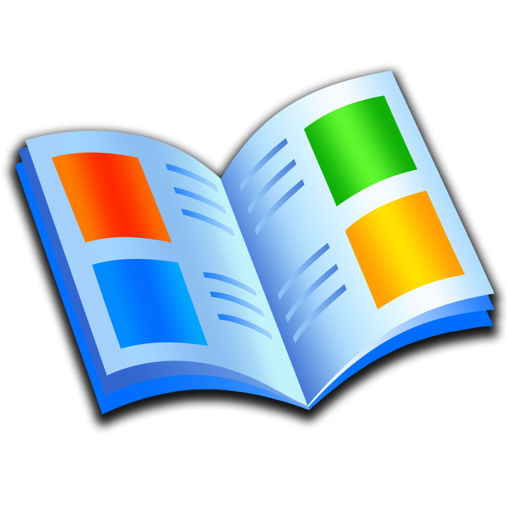
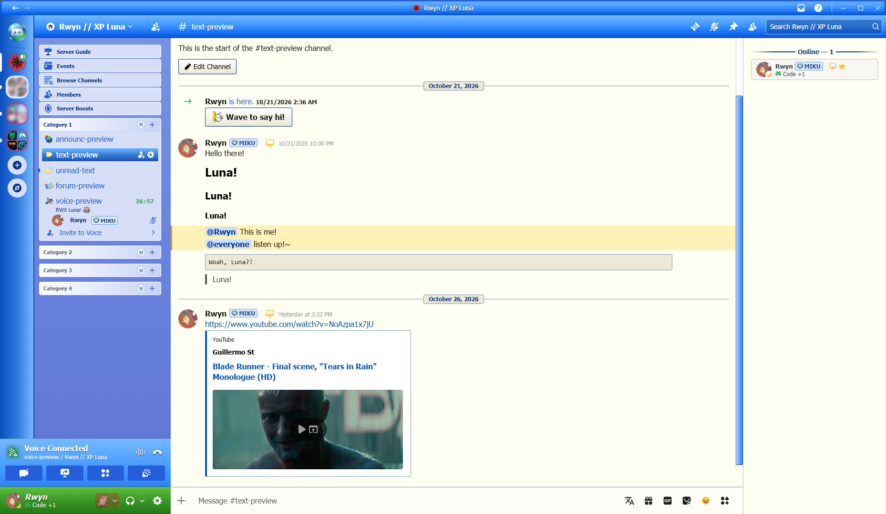
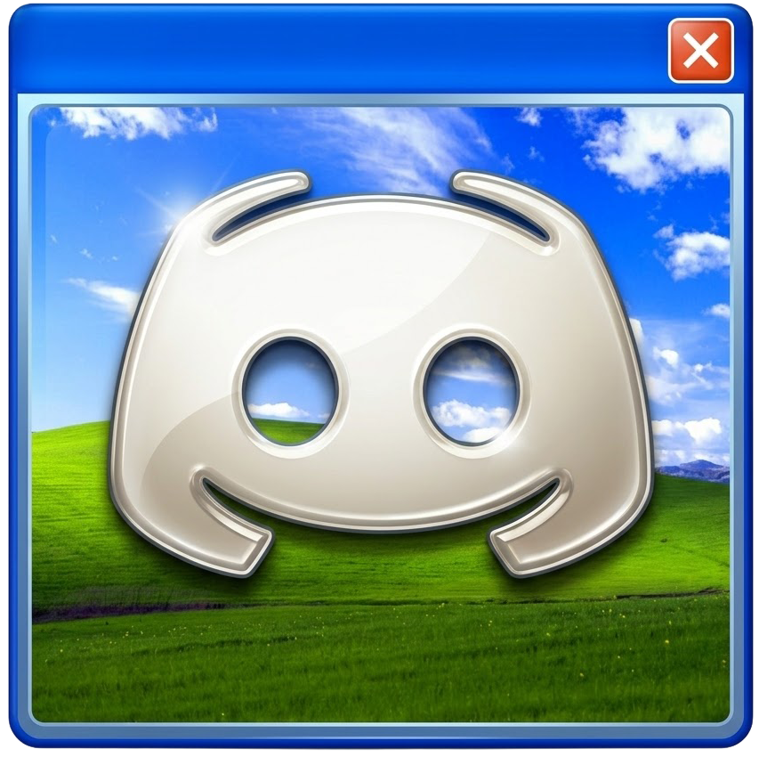

# RWX Luna • Windows XP Luna Theme for Discord

**Quick PSA, this version is still a beta, expect performance and visual issues.**

[](https://github.com/rwynx/RWX-Luna/releases/latest)
[](LICENSE)
[](README.md)
[](https://rwyn.ch/RWX-Luna/RWX-Luna.theme.css?)

**RWX Luna** brings back the classic Windows XP Luna visuals into Discord. Classic royal blue window titlebars, explorer task pane categories on the sidebar, original Shell32 icons and dialog bevels. If you miss the old times like I do...

*RWX (ar-vi-ex) comes from RWyn (ar-win) eXperiments, like any other tool, app or bot of mine.*


<p align="center">
   
     
       
         
           
</p>

---
<br>

<p align="center">
  
</p>


## Features

Don't forget to turn on the 'Window Transparency' feature in your client settings.<br>
For Vencord, it's in: `User Settings` > `Vencord` > `Enable Window Transparency`

- **Luna Look:** I tried to capture the iconic look of Luna with royal blue window headers (`#0054e3`), 3D beveled buttons and classic dialog colors (`#ece9d8`). *Definitely could be improved further...*
- **Different Home Buttons:** RWX Luna has 3 different home button styles, choose one when you download it, or download all and turn on/off them in `Settings > Themes`.<br><br>

<p align="center">
     &nbsp;&nbsp;&nbsp;&nbsp;&nbsp;&nbsp;&nbsp;&nbsp;
     &nbsp;&nbsp;&nbsp;&nbsp;&nbsp;&nbsp;&nbsp;&nbsp;
   
</p>
<br>

- **Shell32 Icons:** Luna uses classic Win XP folder icons for channels (read/unread & announcement channels & forums and voice channels).
If you use emojis in channel names like me `🎤・chat` for example, it might look weird at first, but still nice.
- **Explorer Task Panes:** Channel categories are styled like the classic Windows XP Explorer left sidebar, complete with matching rounded headers and collapsible chevron arrows.

### Home Button Logo Variants

| Variant | Preview | Addon File / Usage |
| :--- | :---: | :--- |
| **Aqua** *(Default)* |  | Default logo |
| **Glassy Aero** |  | `RWX-Luna-GlassyAero.theme.css` |
| **Explorer Bliss** |  | `RWX-Luna-ExplorerBliss.theme.css` |

#### **How to switch this logo in Vencord:**
 Simply place the optional file into your `themes/` folder and toggle it **ON** in `Client Settings → Themes`.

## Installation

### Vencord (Auto Updates)

1. Open Discord settings and head to **Vencord** > **Themes**.
2. Under **Online Themes**, paste:
   ```text
   https://rwynx.github.io/RWX-Luna/RWX-Luna.css
   ```
   *(or `https://rwyn.ch/RWX-Luna/RWX-Luna.css`)*
3. Enable the theme and you're good to go.

### BetterDiscord & Vencord (Manual)

1. Download [`RWX-Luna.theme.css`](https://github.com/rwynx/RWX-Luna/releases/latest/download/RWX-Luna.theme.css) from the [Releases](https://github.com/rwynx/RWX-Luna/releases/latest) (or directly from this repo).
2. Open your Discord themes folder:
   - **BetterDiscord:** `User Settings` > `Themes` > `Open Themes Folder`
   - **Vencord:** `User Settings` > `Vencord` > `Themes` > `Open Themes Folder`
3. Drop `RWX-Luna.theme.css` inside.
4. Toggle **RWX Luna** on in your themes list.

### Replugged

Run this command in your Discord console or terminal:
```bash
replugged install https://github.com/rwynx/RWX-Luna
```
Or clone this repo into your Replugged `themes/` directory.

## CDN

If you want to import the theme directly into QuickCSS or another stylesheet:

```css
@import url("https://rwynx.github.io/RWX-Luna/RWX-Luna.css");
```

GitHub raw fallback:
```css
@import url("https://raw.githubusercontent.com/rwynx/RWX-Luna/main/RWX-Luna.css");
```

## Icon Sources
* Windows XP high quality icon re-creations by **[MarchMountain](https://www.deviantart.com/marchmountain/art/Windows-XP-High-Resolution-Icon-Pack-916042853)**


## Author & License

- **Author:** `Rwyn` ([@rwyn](https://discord.com) on Discord)
- **GitHub:** [https://github.com/rwynx/RWX-Luna](https://github.com/rwynx/RWX-Luna)
- **Design:** Windows XP Luna (2001)

This project is licensed under the [GNU General Public License v3.0](LICENSE) (GPL-3.0).<br>Feel free to use, modify, and share it, provided attribution to `Rwyn` is preserved and derivatives also remain open-source under GPL-3.0.

*Windows XP and associated icons/trademarks belong to Microsoft Corporation.*
